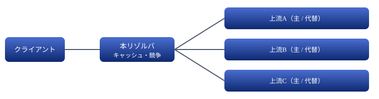

# 計画: 並列問合せ DNS リゾルバ（Node.js）

受けた問合せを複数の上流 DNS へ同時に投げ、最初に返った応答を返す。

> 📅 作成: 2026-10-19 / 更新: 2026-10-20

[⌂](../../README.md)

1. [目的と範囲](#1-目的と範囲)
2. [動作の流れ](#2-動作の流れ)
3. [上流と既定値](#3-上流と既定値)
4. [構成と設定](#4-構成と設定)
5. [テスト](#5-テスト)
6. [決めてほしいこと](#6-決めてほしいこと)

## 1. 目的と範囲

- 手元の PC（または LAN）から使うキャッシュ付きの DNS フォワーダ。**再帰解決はしない**（上流に任せる）
- 上流 3 系統を同時に問い合わせ、**最初に返った正常な応答**を返す。応答が無い系統は代替に切り替える
- 言語は TypeScript（node で直接実行、`tsc` で型チェック）。DNS メッセージは `node:dgram` と自前の最小パーサで扱い、依存パッケージを増やさない（パースは ID の書き換えと TTL の読み取りに要る範囲だけ）
- 範囲外: DNSSEC 検証、権威サーバ機能、DoH/DoT の受け側

## 2. 動作の流れ



1. UDP 53（設定可）で受ける。キャッシュに有効な応答があれば TTL を減らして返す
2. 無ければ 3 系統の**主**へ同時に送る（ID は系統ごとに振り直し、返信を照合）
3. 系統ごとに、主が一定時間（例 300 ms）返さないか失敗したら、その系統の**代替**へ送る（ヘッジ）
4. 最初に返った**採用可能な応答**を、ID を元に戻してクライアントへ返し、残りは捨てる
5. 全滅または全体の期限（例 2 s）で `SERVFAIL` を返す

### 採用可能な応答

- 上流ごとに解決できる範囲が違う（担当外の名前には「解決できない」が返る）。そのため**解決できた応答だけを即座に採用する**
- 解決できた応答: `NOERROR` で回答部に質問の型（または CNAME）を含むもの
- 解決できない応答: `NXDOMAIN`、回答部が空の `NOERROR`（NODATA）、`SERVFAIL`、`REFUSED`、期限切れ。採用せず他の系統を待つ
- **3 系統（代替を含む）がすべて解決できなかったときだけ**、解決できないことを返す。返す内容は `NXDOMAIN` ＞ NODATA ＞ `SERVFAIL` の順で、届いた中で最も強い否定を選ぶ（全系統が無応答なら `SERVFAIL`）
- 否定応答はキャッシュしない（第 1 段階）。担当の上流が一時的に落ちていただけの場合に、否定を返し続けないため
- TC ビット付きは、その上流へ TCP で取り直す（大きな応答に対応）
- クライアントから TCP で来た問合せも受ける（TCP の長さ前置きを扱う）

## 3. 上流と既定値

1 系統＝主と代替の 2 つ。既定値の案（設定で差し替え可）:

| 系統 | 主 | 代替 |
|---|---|---|
| A: Google | 8.8.8.8 | 8.8.4.4 |
| B: Cloudflare | 1.1.1.1 | 1.0.0.1 |
| C: Quad9 | 9.9.9.9 | 149.112.112.112 |

「2 つのドメイン名の既定値」の解釈が決まっていない（[決めてほしいこと](#6-決めてほしいこと) の 1）。

## 4. 構成と設定

```text
src/
  main.ts          起動・引数（--port 等。process.title に反映）
  server.ts        UDP/TCP の受け口
  race.ts          並列問合せ・ヘッジ・期限
  upstream.ts      上流への送受信（UDP、TC 時 TCP）
  dns-message.ts   ヘッダ・質問部・TTL の読み書き
  cache.ts         TTL 付きキャッシュ（件数上限あり）
  config.ts        設定の読み込みと既定値
config/resolver.example.json  上流・待ち時間・ポート（テンプレート。実際に読むのは _resolver.json。i261020-04）
tests/              node:test（bun test でも確認）
tools/40_test/run-tests.ps1 / .cmd
```

- ログは JST `yyyy/mm/dd hh:mm:ss.ccc`。問合せ名・勝った上流・所要 ms を出す
- 上流ごとの勝率・平均応答時間を記録し、起動中に参照できるようにする（第 2 段階）

> [!NOTE]
> **ポート 53** は Windows では管理者権限や既存サービス（ICS 等）と衝突しうる。開発中は 5353 以外の高位ポート（例 10053）を既定にする。

## 5. テスト

- 上流を偽の UDP サーバ（遅延・失敗・SERVFAIL を指定できる）で立て、実ネットに出ない
- 保証すること: 一番速い上流の解決できた応答が返る ／ 先に NXDOMAIN が返っても、後から解決できた系統の応答が返る ／ 全系統が NXDOMAIN なら NXDOMAIN ／ 主が遅いと代替へ切り替わる ／ 全滅で SERVFAIL ／ 返す ID が元の ID ／ キャッシュが TTL で切れる ／ TC で TCP に取り直す

## 6. 決めてほしいこと

### 決定（2026-10-19）

- 上流は IP アドレスで持つ。primary / secondary のペアを 3 組（組数は設定で変えられる）
- 代替へ送る条件は 2-A（主が一定時間返さなければ代替にも送る）
- 待受けは 3-B（LAN にも公開）。開いたリゾルバとして外から悪用されないよう、受け付ける送信元を、設定に書く許可リスト（サブネットを CIDR で複数、例 `["127.0.0.0/8", "192.0.2.0/24"]`）で絞る。リストに無い送信元は、UDP は黙って捨て、TCP は接続を閉じる
- 受け口は UDP と TCP の両方を同じポートで待ち受ける（`node:dgram` と `node:net`）。TCP は 2 バイトの長さ前置きを扱い、1 本の接続で続けて来る問合せにも応える

### 実装の結果（2026-10-19）

- 計画どおり実装した。テストは 38 件（tsc・node --test・bun test とも通過）
- 計画から足したもの: primary が「解決できない返事」をしたときは、待ち時間を待たずに secondary へ送る。全組の secondary まで返し終えたら、期限を待たずに否定を返す
- 上流への問合せは、上流ごとに ID を振り直し、送り先・ID・質問部が一致する応答だけを受ける
- キャッシュする TTL の上限は 1 日
- 第 2 段階（上流ごとの勝率・平均応答時間の記録）は、集計をログへ定期的に出す形で実装した（課題 i261019-02）
- ポート 53 で起動し、Windows の nslookup から使えることを確かめた（課題 i261019-01）

### 当初の選択肢

1. 「3 つの DNS resolver は 2 つのドメイン名のデフォルト値を持つ」の意味
    - **1-A**: 各系統が主・代替の 2 つの既定アドレスを持つ（上表。3×2＝6 で「代替で 6 つ」と合う）。推す理由: 依頼文の件数と一致する
    - **1-B**: 上流をアドレスでなくホスト名（`dns.google` 等）で持ち、DoH/DoT で問い合わせる
    - **1-C**: 系統ごとに 2 つのドメイン（名前の接尾辞）を担当させ、そのドメインは特定系統へ振り分ける
2. 代替へ切り替える条件
    - **2-A**: 主が一定時間返さなければ代替も送る（ヘッジ）。推す理由: 遅延を抑えつつ送信量は増えにくい
    - **2-B**: 最初から 6 つ全部へ同時に送る
3. 待受けの範囲: **3-A** 127.0.0.1 のみ（推す理由: 外から使われない） ／ **3-B** LAN にも公開

[⌂](../../README.md)
